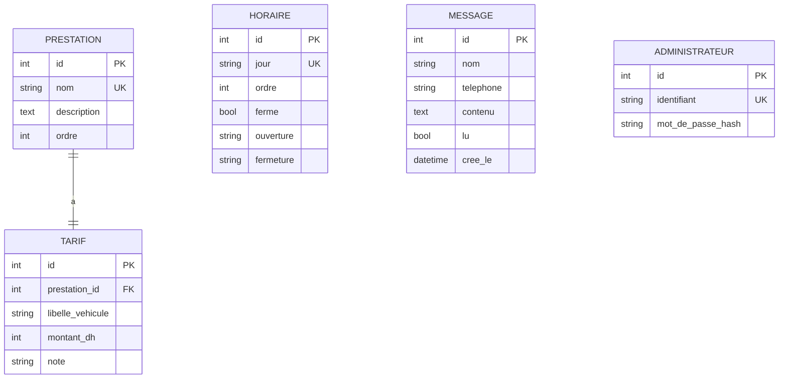

# Conception

## Architecture
Application web Python **FastAPI** : routes (`routers/`) → validation (`validation.py`) → modèles SQLAlchemy (`models.py`) → base SQL.
Les pages sont générées côté serveur (Jinja2). Un seul petit appel JSON (`/api/tarifs`) alimente le simulateur en JavaScript.

Choix : SQLite par défaut (aucun serveur à administrer, adapté à un petit site), PostgreSQL possible en changeant `DATABASE_URL`.
Pas de framework JavaScript : le site est léger et l'essentiel fonctionne sans JS.

## Modèle de données (MCD)

Contraintes en base : `nom` et `jour` uniques, `montant_dh > 0` (CHECK), un tarif par prestation (UNIQUE sur la clé étrangère), suppression en cascade.

## Routes

| Méthode | Chemin | Accès | Rôle |
|---|---|---|---|
| GET | `/` | public | page d'accueil (données lues en base) |
| GET | `/api/tarifs` | public | tarifs en JSON |
| POST | `/contact` | public | enregistrer un message |
| GET | `/confidentialite`, `/sante`, `/robots.txt`, `/sitemap.xml` | public | pages techniques |
| GET/POST | `/admin/login`, POST `/admin/logout` | public / admin | session |
| GET | `/admin/` | admin | tableau de bord |
| POST | `/admin/tarifs/{id}`, `/admin/horaires/{id}` | admin | modifier |
| POST | `/admin/messages/{id}/lu`, `/supprimer` | admin | gérer les messages |

Toute modification passe par un POST + jeton CSRF, puis redirection (Post/Redirect/Get).
